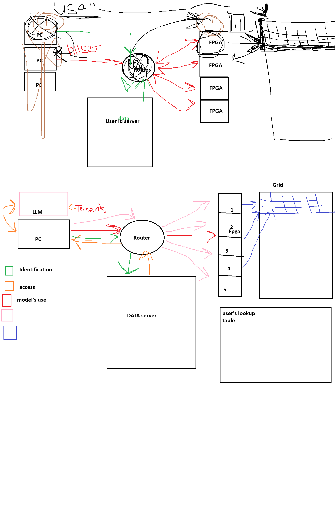

# HLLSet в Cisco Packet Tracer

Сетевая модель HLLSet-системы в **Cisco Packet Tracer 9.0**: пользователи, маршрутизатор с ACL, сервер идентификации, планировщик, рой из 5 одинаковых «FPGA»-плат и общая решётка Grid.

На SBC-узлах PT работает настоящий HLLSet-код на Python. Хеш MurmurHash3 и вставка `(reg, tz)` совпадают бит в бит с [hllset-fpga-simulator](https://github.com/alexmy21) и `hllset-core`.

Основа: чертёж архитектуры, репозиторий `hllset-next-v2` и статьи *Emerging World Models* и *The EWM Lattice and Its Worlds* (A. Mylnikov et al., 2026).



## Топология

```
                         [R1  ISR4331]  router-on-a-stick, DHCP, ACL
                              |
 ADMIN ------------- [SW-CORE 2960] ------ DATA (SBC)        идентификация / доступ
                     |       |      \----- DISPATCHER (SBC)  планировщик роя
                     |       |
             [SW-USERS]    [SW-SWARM]
            user1..user3   FPGA1..FPGA5 (SBC)   GRID (SBC)
```

| VLAN | Сеть | Узлы |
|---|---|---|
| 10 USERS | 192.168.10.0/24 | user1–3 (DHCP) |
| 20 SERVICES | 192.168.20.0/24 | DATA .10, DISPATCHER .20 |
| 30 SWARM | 192.168.30.0/24 | FPGA1–5 .11–.15 |
| 40 GRID | 192.168.40.0/24 | GRID .10 |
| 99 MGMT | 192.168.99.0/24 | ADMIN, управление коммутаторами |

Подробности: [docs/PLAN.md](docs/PLAN.md).

## Потоки (цвета чертежа)

| Цвет | Путь | Что идёт |
|---|---|---|
| 🟢 идентификация | user → DISPATCHER → DATA | логин / пароль |
| 🟠 доступ | DATA → DISPATCHER → user | токен доступа, seed мира |
| 🔴 использование модели | user → DISPATCHER → любая FPGA | загрузка текста, запросы |
| 🔵 решётка | FPGA ↔ GRID | MERGE / GET / PUT плоскостей, LUT |

## Что показывает модель

- **Рой без синхронизации.** Текст делится между 5 платами, каждая ORит свою часть в один узел Grid. Порядок прихода частей разный, а итоговый CID один и тот же (union монотонен и коммутативен).
- **Existence is registration.** Каждый результат (∪, ∩, D/R/N) регистрируется в Grid под CID `h:<sha1>`.
- **Миры пользователей.** У каждого пользователя свой seed. Один и тот же текст даёт разные биты, а читать узлы можно только через свою LUT.
- **Целое — на FPGA, float — на хосте.** Платы отдают гистограмму `c_s`, кардинальность (логарифмы) считает клиент.
- **Сетевая защита.** Изоляция миров в статье структурная, а не криптографическая, поэтому поверх неё стоят VLAN, ACL и токены.

## Результаты прогона в PT 9.0

```
INGEST doc1 -> cid=h:9229c0b27ac1... bits=8  boards=FPGA1:2 FPGA3:2 FPGA5:1 FPGA2:2 FPGA4:2
QUERY UNION doc1 doc2      -> doc1+doc2  h:a32ffb02b01d...  13
QUERY INTERSECT doc1 doc2  -> doc1*doc2  h:eb184778926c...   3   (R-link)
QUERY DRN doc1 doc2        -> D=5  R=3@h:eb184778926c  N=5
QUERY HIST doc1            -> c_s=6,1,1,0,...  card~8
QUERY LOOKUP doc1*doc2     -> fox quick the
user2 / doc1 (тот же текст) -> h:7b0bc8c0f0c5...  (другой мир)
user3: bad login -> DENY, fake token -> DENY, direct FPGA:5100 -> BLOCKED (ACL)
```

## Структура репозитория

| Папка | Что внутри |
|---|---|
| `configs/` | конфиги R1 и коммутаторов, ACL |
| `scripts/` | готовые `main.py` для каждого SBC (собраны из `src/`) |
| `src/` | исходные модули: хеш, SHA-1, сеть, роли узлов; `build.py` |
| `tests/` | эмулятор сетевого API PT и проверки хеша и SHA-1 |
| `tools/probe.py` | проверка возможностей Python в PT |
| `docs/` | план сети, тесты, запуск, особенности PT |
| `pt/` | файл проекта Packet Tracer (`.pkt`) |

## Быстрый старт

1. Собрать сеть по [docs/PLAN.md](docs/PLAN.md) и вставить конфиги из `configs/`.
2. Проверить связность и ACL по [docs/TESTS.md](docs/TESTS.md).
3. Вставить скрипты из `scripts/` в `main.py` на каждом SBC и запустить по [docs/RUN.md](docs/RUN.md).

Изменять нужно модули в `src/`, а не готовые скрипты. После правок:

```
python src/build.py scripts
pip install -r tests/requirements.txt
python tests/check_murmur.py src
python tests/sim.py scripts
python tests/verify.py scripts
```

## Упрощения модели

- CID = SHA-1 канонического списка позиций, а не сериализованного Roaring-битмапа.
- Только униграммы; 3-граммы, TF-ранги и временная пирамида L0–L6 — следующие итерации.
- Токены без срока жизни, пароли в открытом виде; данные Grid живут в памяти SBC.
